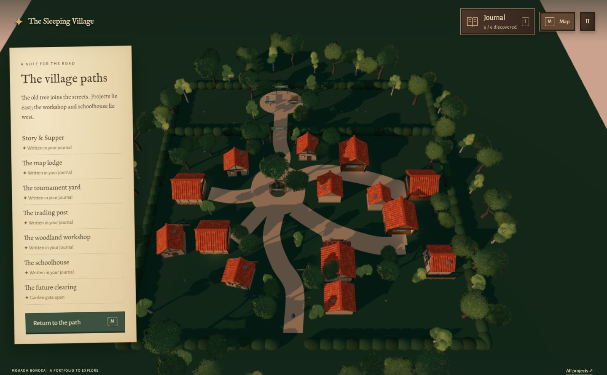

# The Sleeping Village

**A desktop-first 3D portfolio by Mouadh Bondka, built as a small woodland village you can explore in your browser.**

Visitors guide a traveler through a village at sunset, discover projects and professional experience at its buildings, and collect their stories in a personal journal. The aim is to introduce Mouadh’s software engineering work through a coherent, playful experience, while giving recruiters and other visitors a direct way to browse every entry without playing.

**Current status:** a working local prototype. The village, movement, camera, journal, and shared game UI are implemented. Project presentations are still being developed, and this portfolio has not been published.



## The experience

The woodland entrance bends toward a compact square around an old tree. Two project streets branch east; the workshop and schoolhouse sit along western lanes. Closed cottages, gardens, hedges, and woodland frame the streets. This walkable layout follows the owner's hand-drawn map and is ready for another spatial review before detailed furnishing.

| Village destination | What it presents | Current state |
| --- | --- | --- |
| Story & Supper tavern | Smosh Story Finder | Most developed showcase: furnished tavern, interactive ledger, project story, engineering notes, screenshot, and live archive link |
| Woodland workshop | Professional experience | Journal pages about Sopra Steria and La Banque Postale |
| Map lodge | Comp Atlas | Short entry; product remains private, with screenshots and a video showcase planned |
| Trading post | Bargainy | Short project and engineering entry |
| Tournament yard | DuelSync | Short desktop-project and engineering entry |
| Schoolhouse | Education and selected skills | Two short pages based on the existing CV-derived content draft |
| Future clearing | Manart and an unnamed penguin board game | Bonus chapter beyond the northern gate; opens after discovering all six main entries |

The entrance has a welcome/tutorial sign, and the square provides directions. Six symbols on the garden gate show progress. All entries, including future projects, can also be read through **Browse all projects**, without changing exploration progress.

## What is built so far

- An animated traveler with walking and sprinting, an over-the-shoulder camera, collision handling, and camera clearance around walls and furniture. Movement is grounded, with no jumping or climbing.
- A village with six open-front destinations, eight closed background cottages, branching paths, a central tree and benches, woodland borders, and a sunset palette with deeper forest greens and warm lantern light.
- A detailed Story & Supper tavern with a discoverable ledger, serving counter, shelves, reading and supper tables, benches, terrace seating, candles, and other props.
- Six main journal discoveries plus a bonus future-project chapter. The northern garden gate physically blocks passage until all six main entries are discovered, then opens automatically. New discoveries show a notice; revisiting an entry does not unlock it again. Unwritten entries show clues.
- A journal with Contents as its single global bookmark. Each entry has its own page arrows, section label, and keyboard navigation.
- Matching welcome, pause, settings, map, notice, interaction prompts, and HUD, using leather, parchment, and cloth-bookmark styling.
- The **Worn Traveler’s Journal** font pairing: IM Fell English for titles, Alegreya for reading, and Alegreya Sans for controls. Font files are bundled with the game.
- Mouse sensitivity and low-graphics settings, modal keyboard navigation, reduced-motion styling, and stacked journal pages for narrow windows.
- Automated checks for physics, camera movement, and discovery persistence, plus recorded visual checks in `planning/`.

### Saved discoveries

Discoveries are stored in the visitor’s browser under `sleeping-village.journal.v1`. They survive refreshing, and the gate reopens from the saved six discoveries; the traveler’s position and settings currently do not. Different browsers and site addresses have separate saves. Clearing site data removes the discoveries. Older saves retain their entries: a previously found future chapter remains readable but does not replace education in the six-entry gate requirement.

If browser storage is unavailable, entries still work for the current visit and the journal explains that saving is unavailable. Direct browsing shows all entries without changing discovery progress. There is no account or cloud synchronization.

## Run locally

The project uses Node.js and npm. The current development environment uses **Node.js 22.22.0**. Dependencies stay inside this folder; no global library or font installation is needed.

From this directory, install the locked dependencies if they are not already present, then start the preview:

```sh
npm ci
npm run dev
```

Open **http://127.0.0.1:5173/** in a desktop browser. On Windows, once dependencies are present, you can also double-click **Start Village.bat**. Keep its terminal window open while playing; press **Ctrl+C** or close that window to stop the server.

The preview listens on this computer’s loopback address. Port 5173 must be available. If PowerShell blocks npm’s script wrapper, use `npm.cmd` for the same commands.

### Controls

| Input | Action |
| --- | --- |
| WASD or arrow keys | Walk |
| Shift while moving | Run |
| Mouse | Look around after entering the village |
| Right mouse button + drag | Look around when pointer capture is unavailable |
| E near a point of interest | Discover or revisit an entry; read the notice at the square |
| J | Open or close the journal |
| Left / right arrows while reading an entry | Turn its pages |
| M | Toggle the overhead village map |
| Esc | Pause during play; close the current journal or menu |
| Browse all projects / All projects | Read every entry without exploring |

The pause menu includes the journal, map, settings, return to the entrance, and main menu. Movement pauses while reading entries or menus.

## Build and checks

| Command | Purpose |
| --- | --- |
| `npm run dev` | Run the local development preview |
| `npm run build` | Check TypeScript and generate the static site in `dist/` |
| `npm run preview` | Serve the generated build locally after building |
| `npm test` | Run physics, camera, and journal persistence checks |

The tests cover a continuous trip through every village stop, movement speed, entrances, rotated walls, furniture, closed cottages, locked/open gate collision, fence bypass prevention, bounds and reset; sprint camera behavior at multiple frame rates and uneven timings; and journal save/reload, gate progression, old saves, duplicate discoveries, invalid records, and unavailable storage. Browser checks and screenshots are recorded in [planning/SKETCH_LAYOUT_CHECKS.md](planning/SKETCH_LAYOUT_CHECKS.md), [planning/JOURNAL_CHECKS.md](planning/JOURNAL_CHECKS.md), and the other planning notes.

## Technical approach

The game is built directly for the browser with **React 19, TypeScript, Three.js, React Three Fiber 9, Rapier, and Vite**. It runs as a client-side application without a portfolio backend or database.

Physics advances at a fixed 60 Hz timestep, with interpolated traveler and camera rendering. A shared layout definition drives buildings, destination triggers, and collision geometry. Static colliders approximate furnishings; foliage is decorative. Current movement tuning is 2.9 m/s walking, 5 m/s sprinting, and 0.7× default mouse sensitivity.

The evening look uses scene lighting and shared foliage material variants. The font files are served locally and total about 127 KiB; their licenses and download hashes are retained.

### Project structure

| Path | Responsibility |
| --- | --- |
| `src/App.tsx` | Game modes, menus, interaction flow, and journal unlocks |
| `src/Game.tsx` | Traveler, scene integration, and input |
| `src/village.ts` | Shared world layout, destinations, and colliders |
| `src/VillageScene.tsx`, `src/SceneObjects.tsx` | Environment rendering and reusable scene objects |
| `src/Tavern.tsx` | Story & Supper furnishings |
| `src/physics.ts`, `src/player-view.ts`, `src/tuning.ts` | Movement, physics, camera behavior, and tuning |
| `src/Journal.tsx`, `src/Modal.tsx`, `src/style.css` | Journal presentation and shared game UI |
| `src/journal-data.ts`, `src/discoveries.ts` | Entry content and browser persistence |
| `src/atmosphere.ts`, `src/assets.json` | Visual palette and selected asset paths |
| `public/` | Assets, screenshots, fonts, and licenses served with the game |
| `scripts/` | Automated checks and asset preparation tools |
| `planning/` | Content drafts, asset records, design notes, and visual evidence |

## Assets and credits

The selected environment assets come from Quaternius’s **Medieval Village MegaKit**, **Ultimate Stylized Nature**, and **Fantasy Props MegaKit**, using the supplied free assets. The customized traveler is based on KayKit assets. Relevant license files are retained under `public/assets/`.

The ready-to-run asset subset is committed under `public/assets/`; a normal checkout does not need the complete source packs. To add or rebuild the selected subset, restore the original packs under the ignored `asset-packs/` directory and use the asset preparation tools. That optional preparation workflow uses Python and Pillow; neither is required to run the already prepared game. Receipts under `public/assets/` record source and processed hashes.

The locally bundled fonts and their SIL Open Font License files are in [public/fonts/](public/fonts/). Smosh Story Finder is an independent fan-made project; Smosh branding and content belong to their respective owners.

## What is still planned

- Expand the other project presentations and professional-experience material beyond their current short journal entries.
- Add Comp Atlas screenshots and a video walkthrough while keeping the application private.
- Add more project media and verify any additional public links.
- Finish CV and contact actions so visitors can follow up easily.
- Give the remaining buildings their own more complete displays and interactions.
- Continue usability, accessibility, browser, and performance testing before publishing.

Manart and the penguin board game remain future-project entries, with their actual development stages stated clearly. The portfolio itself is still a prototype, with desktop mouse-and-keyboard play as its primary experience.

## Local files and version history

Git tracks source, configuration, the lockfile, planning notes and screenshots, and the assets, fonts, and licenses needed to run the game. `.gitignore` excludes dependencies, caches, build/test output, original asset packs, local environment files and credentials, personal editor settings, temporary files, and obsolete cloud-transfer materials. Ignored files remain on disk. Keep `package-lock.json` and the files in `public/` tracked so a checkout stays reproducible.

The first checkpoint, `6de0b7e`, captures the village and journal prototype as it existed when Git was introduced. Earlier iterations were not individually tracked. Development checkpoints are saved locally; no remote is configured and nothing has been pushed.

Use `git status` and `git diff` to review pending changes, and `git log --oneline` to see checkpoints. To record a reviewed milestone:

```sh
git add -A
git commit -m "Describe the change"
```

To reclaim development space, stop the server and remove only `node_modules/`, `.cache/`, and `dist/` from this game folder. Keep the source, configuration, lockfile, and runtime assets; `npm ci` restores dependencies when needed. Original asset packs are separate local source material and are not recoverable from this Git repository.
