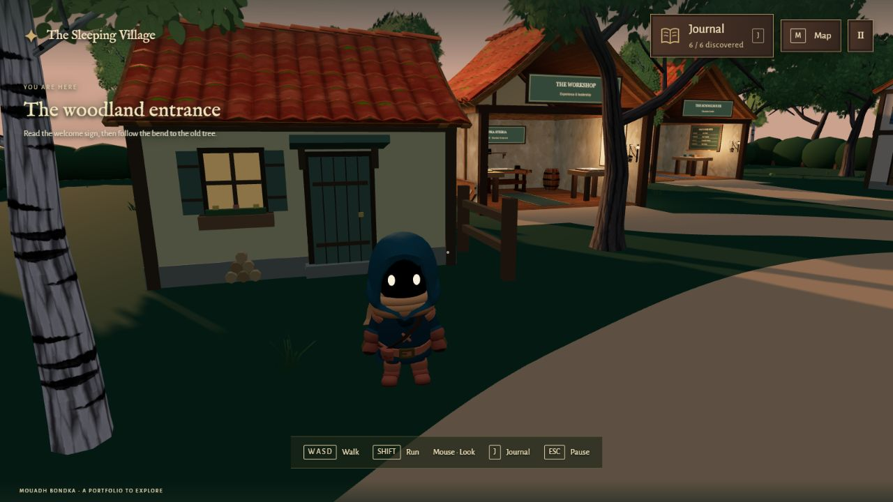
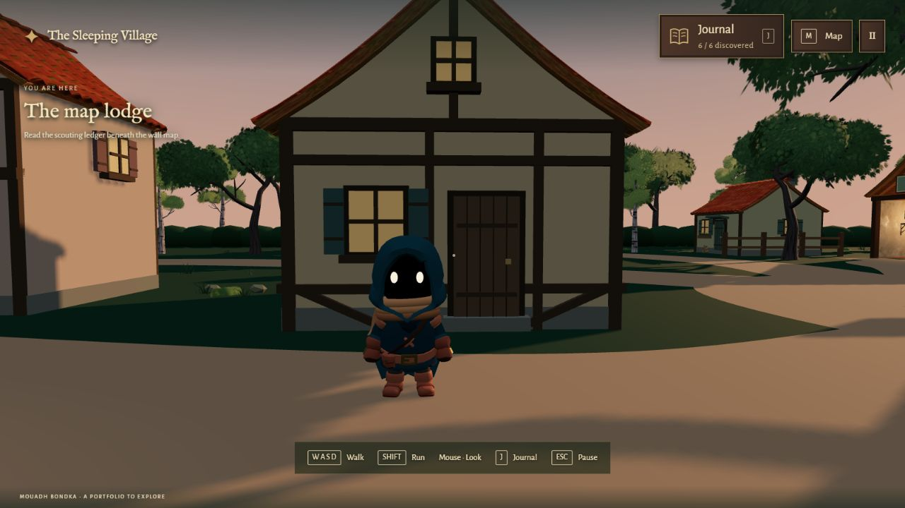
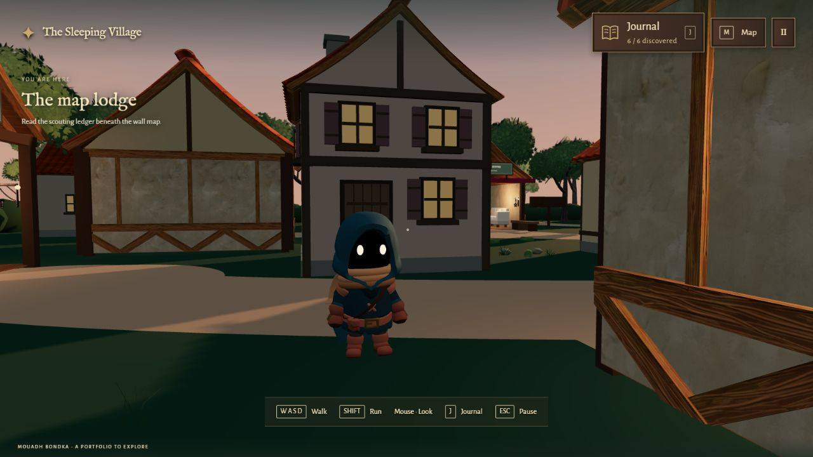
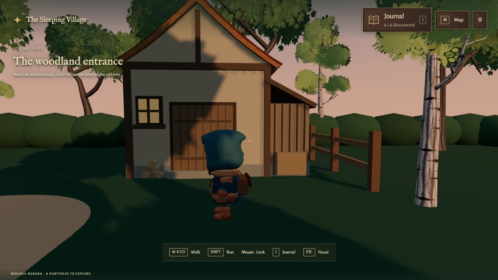
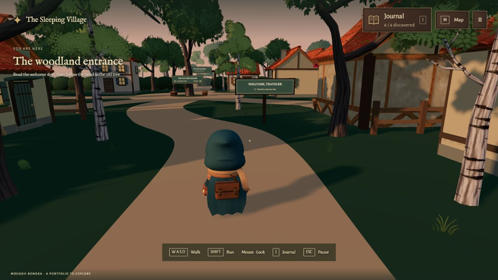

# Background home variety

## Design

The eight closed background homes now use four designs: three low cottages, two narrow two-storey homes, two timber-framed homes, and one storehouse. Roof heights, ridge direction, plaster/shutter colors, window placement, capped chimneys, flower boxes and small firewood piles vary. The storehouse has a lower timber lean-to and broad planked doors. Side and rear windows keep the homes readable from the surrounding lanes.

The six project/experience/education buildings, their furnishings, interactions and signs are unchanged. The background houses retain their locations and door directions. Two tall homes are slightly narrower; all other footprints remain the same. No new lights, animations, dependencies, models or texture files were added.

## Rendering and loading

Walls, door planks, beams, shutters and canopies use one static InstancedMesh with per-instance color. Window panes, firewood and gable triangles each use a separate shared batch. The existing tiled roof geometry/textures remain shared, with two cached material tints for the taller houses and storehouse. Instance bounds are computed once; no per-frame house updates are needed.

At the same original entrance position and look angle, with a 1600 × 900 canvas, full graphics and six discoveries:

| Renderer counter | Before | After |
| --- | ---: | ---: |
| Draw calls | 1,236 | 1,163 |
| Triangles | 368,519 | 376,181 |

The richer facades add about 2.1% to submitted triangles in this view while reducing draw calls. This is a matched-view spot check, not an FPS benchmark or a guarantee for every device/viewpoint.

The final entry, game and Three.js bundles together add 2,682 gzip bytes compared with the preceding live version. Existing model, texture, font and audio payloads are unchanged. Planning screenshots are repository evidence and are not copied into the public game build.

## Verification

- Full physics tour still reaches all six destinations and the opened future clearing. Walking/running speed, gate blocking, furniture, boundary and reset checks pass.
- Additional physics checks approach every closed house and verify its solid doorway, wall and roof camera clearance. Collision boxes use the same home dimensions as the visuals, including stepped roof and lean-to proxies.
- Camera, journal, gate progression, Escape/mouse capture and recorded-audio regressions pass. Production build and all 80 `/village/` resource checks pass.
- Close-up browser reviews cover all four designs. Temporary review spawn/camera changes were restored before the final checks; the production starting point remains `[4, .74, 28]`, yaw `0`, pitch `.23`.

## Views

