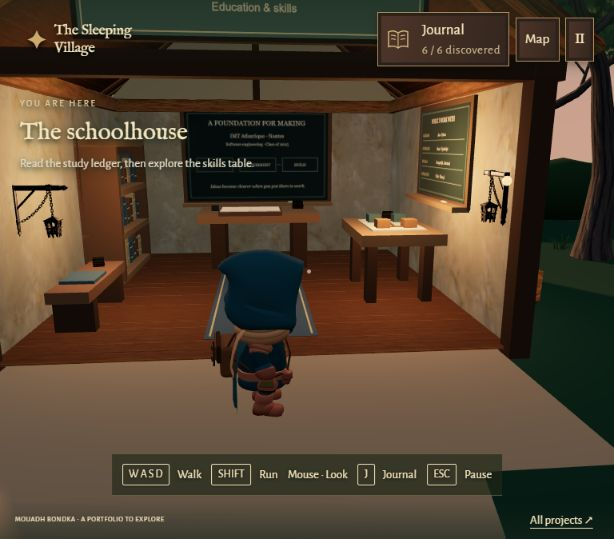

# Schoolhouse — 27 October 2026

The schoolhouse now has a study desk and open ledger beneath a chalkboard, a filled bookcase and reading bench on the left, and a skills table with a wooden system model and a second chalkboard on the right. A blue-grey runner and warm lantern light keep it within the village palette. The entrance sign is raised to reveal the room.

The study ledger opens Education (page 1); the skills display opens Skills (page 2). Both belong to the existing `education` discovery. Approved copy, old saves, and the six-entry gate progression are preserved. Furnishings reuse existing models and code-drawn geometry/textures; no new dependencies or asset downloads.

## Checks

- Production build and all physics, camera, and journal tests passed.
- Extended the continuous village tour to reach both schoolhouse displays, verify their page targets, test collisions against the desk, skills table, bookcase, and bench, and reject reading through exterior walls or from outside the entrance.
- Browser: inspected the room, lowered/resized the rear chalkboard to keep its heading below the wall beam, walked from the entrance to the ledger and across to the skills table, and opened both matching pages with E. Existing discovery count remained 6 / 6.
- A temporary source-level spawn and camera orientation placed the traveler at the schoolhouse entrance for visual inspection. Both were restored to normal before the final build/tests. No debug spawn remains.

