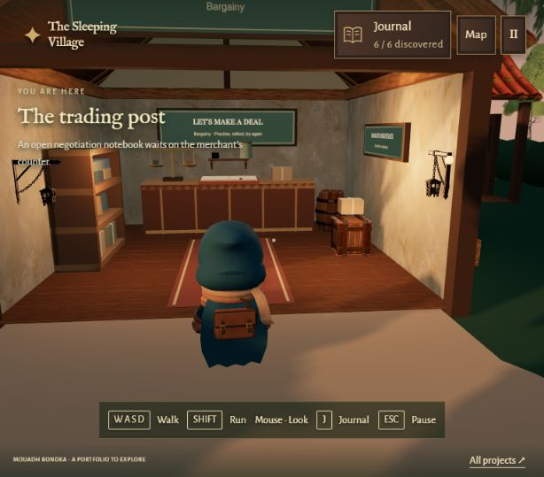
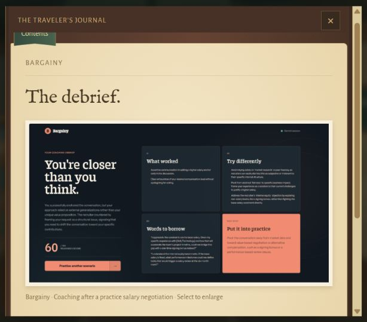

# Trading Post / Bargainy — 27 October 2026

Implemented the approved three-page entry: The idea, My work, and Gallery. The opening uses the approved joined sentence, “People usually know what they want, but rarely get the chance to practise asking for it.” The technical page explains separate counterpart/coach context and structured feedback. The supplied debrief screenshot confirms the readiness-score label.

The screenshot is copied unchanged to `public/images/bargainy/coaching-debrief.png` (1537 × 813). Its SHA-256 matches the supplied file: `90DBDB1D97B22D93AD14B9CE106E372F45B506DFDBF9016960BE299C10770777`. The Gallery shows the full image with descriptive alt text and a link to enlarge it. No live-product URL was added.

The room has a wooden merchant’s counter with an open negotiation notebook and balance scale, stocked shelves with jars and folded cloth, parcels, a barrel, and a crate. A terracotta runner echoes Bargainy’s warm accent. The raised entrance sign leaves the room visible. Furniture footprints drive collision geometry, and the central aisle remains clear.

## Validation

- Production build and complete physics, camera, and discovery suites passed after restoring the normal spawn.
- Continuous village tour reaches the notebook. Additional checks verify the counter, goods shelves, and crate collisions, plus rejection of interaction through exterior walls or from the street.
- Browser: walked from the Trading Post entrance to the notebook, pressed E, and read all three pages. The supplied image loaded at its original dimensions. Existing progress remained 6 / 6.
- Temporary source-level spawn at the Trading Post entrance was used for inspection and removed before final build/tests. Normal camera settings are unchanged.
- No dependencies, global tools, or asset packs were installed. Furnishings reuse existing models and code-drawn objects/textures.

