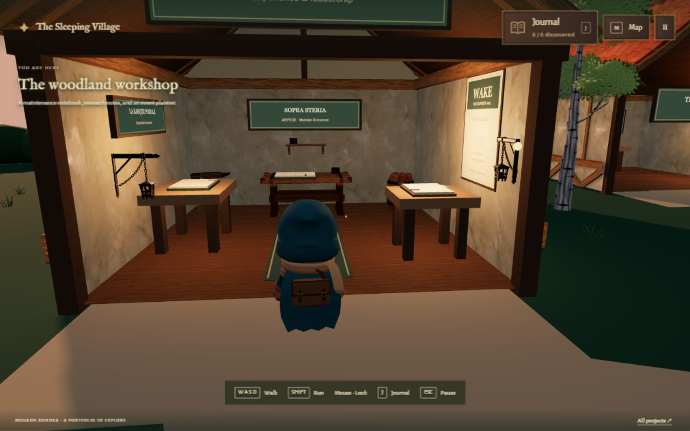
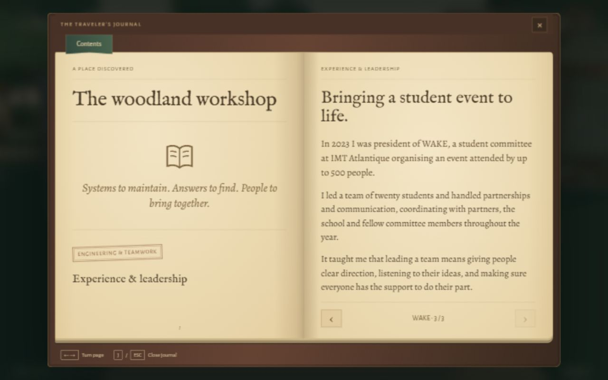

# Workshop — 26 October 2026

Implemented the approved Sopra Steria, La Banque Postale, and WAKE journal copy. WAKE now lives in the workshop, with its teamwork/leadership closing paragraph; the schoolhouse retains education and skills.

The room has a maintenance workbench and notebook at the back, a document-research desk on the left, and a smaller WAKE planner and event poster on the right. Existing anvil, barrel, books, shelves, and lantern assets accompany the new desks, notebooks, and green runner. The entrance sign was raised and reduced after visual inspection because it hid the displays.

Each display offers its own interaction prompt and opens its corresponding page in the same `workshop` entry. Revisits and existing saves remain compatible; the garden still requires six main discoveries. No new model downloads, libraries, or global tools were added.

## Validation

- Production build passed.
- Full physics, camera, and journal suites passed after restoring the normal entrance spawn and camera orientation.
- Extended the continuous physics tour to visit all three display approaches, assert their distinct page targets, verify desk collisions, and reject workshop interaction outside the entrance or through side walls.
- Browser: read all three pages and checked the WAKE spread at 1280 × 800. Pressing E at the WAKE planner opened page 3 directly. The saved count remained 6 / 6.
- Browser: inspected furnishings and the clear central aisle. Temporary source-level spawn/camera positions were used to inspect the room efficiently; these were removed before the final build and tests. Normal movement/collision coverage comes from the continuous automated tour.

